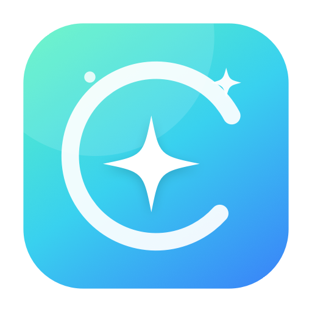
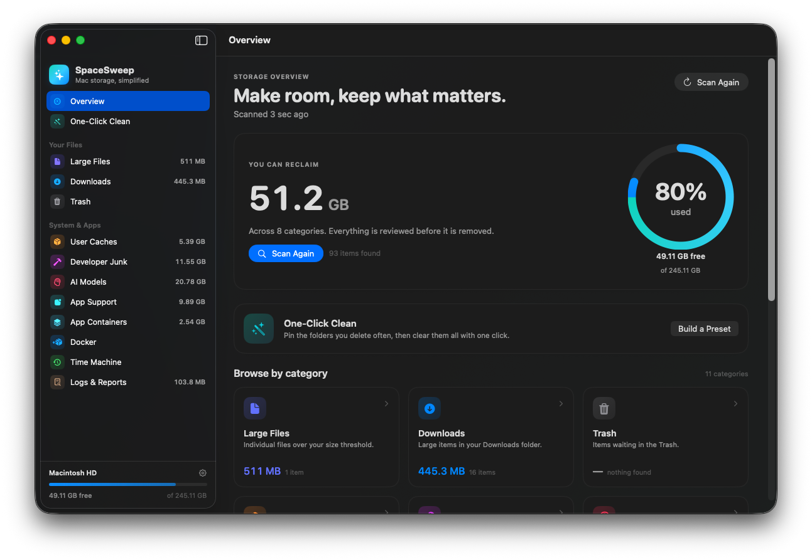

<h1 align="center">
  
  SpaceSweep
</h1>

<p align="center">
  A native macOS disk cleaner that shows what is actually taking up space and lets you remove it deliberately.
</p>

SpaceSweep scans the places that quietly grow — caches, Downloads, the Trash, developer build artifacts, AI model stores, app containers, Docker resources, and local Time Machine snapshots — then puts every result in a reviewable list. Nothing is removed automatically. You choose the items, confirm the review, and only then does it clean.

Built with SwiftUI and Swift Package Manager. No accounts, analytics, network calls, or helper daemons.

 



## Highlights

- **Native SwiftUI interface** with a sidebar, dashboard, category lists, and a focused cleanup flow.
- **Incremental scanning** — results appear category by category while the scan continues in the background.
- **One-Click Clean** — save the items you remove regularly, review their current sizes on each scan, and clean them together.
- **Trash-first safety** — items move to the Trash by default. Permanent deletion requires a separate acknowledgement.
- **Transparent actions** — Docker and Time Machine entries show the exact command they will run.
- **Search, sort, and selection** across every category, with a running reclaimable total.
- **Local only** — file names, paths, and sizes never leave the Mac.

## What it scans

| Category | What it finds |
| --- | --- |
| **Large Files** | Individual files above your size threshold in your home folders, plus the configured result limit. |
| **Downloads** | Large files and folders in `~/Downloads`. |
| **Trash** | Items waiting in `~/.Trash`. Removing these deletes them permanently, since they are already in the Trash. |
| **User Caches** | Rebuildable caches in `~/Library/Caches` and `~/.cache`, grouped by owner and size. |
| **Developer Junk** | Xcode DerivedData, Archives, device support, simulator caches, Homebrew downloads, npm/pnpm/yarn, pip, Cargo, Gradle, Maven, Playwright, Electron, and similar tool caches. |
| **AI Models** | Hugging Face hub blobs and datasets, Ollama models, LM Studio models, Unsloth, and other local model stores. |
| **App Support** | Large folders in `~/Library/Application Support`, with app-aware names. |
| **App Containers** | Sandboxed data in `~/Library/Containers` and `~/Library/Group Containers` (Docker's container is excluded and handled separately). |
| **Logs & Reports** | Logs and diagnostic/crash reports in `~/Library/Logs` and `~/Library/DiagnosticReports`. |
| **Docker** | Unused images, stopped containers, unused volumes, and build cache through the Docker CLI. |
| **Time Machine** | Local APFS snapshots reported by `tmutil`, removed with `tmutil deletelocalsnapshots`. |

The thresholds and result count are configurable in **Settings → General**.

## One-Click Clean

1. Open a category and select the files or folders you remove regularly.
2. Click the bookmark button on a row, or select several rows and choose **Save to One-Click Clean**.
3. Open **One-Click Clean**, review the saved entries and their current sizes, then press **Clean Now**.

Saved entries are stored locally in `UserDefaults` and re-matched against every scan. If a saved path is no longer present, it is marked **Not found in the latest scan** and skipped. Stale entries can be removed in one action, or cleared entirely from Settings.

## Safety model

SpaceSweep is intentionally conservative:

- **Trash by default.** Files and folders are moved with `FileManager.trashItem`, so they can be recovered.
- **Permanent deletion is explicit.** The cleanup sheet requires an extra confirmation before any permanent removal.
- **Home directory only.** Every file action is validated to resolve inside your home folder. The home folder itself, the volume root, and protected locations such as `~/Library`, `~/Documents`, `/System`, `/usr`, and `/private` cannot be removed.
- **Top-level folders are protected** unless they are known model stores (`.ollama`, `.unsloth`, `.omlx`).
- **Symlink checks.** A path that resolves to `/` is rejected.
- **Trash is handled correctly.** Moving an item out of `~/.Trash` to the Trash is impossible, so Trash cleanup is permanently deleting already-discarded items. This is stated in the UI.
- **No raw removal commands.** `rm`, `sudo`, shells, `dd`, `diskutil`, and similar executables are rejected. Only a fixed set of Docker and `tmutil` commands is offered, and they are visible before running.
- **Admin operations use the system authorization prompt.** Time Machine snapshot deletion is marked as requiring admin rights.

Cleanup happens one item at a time with progress reporting. Failures are collected into a result summary rather than aborting the whole run.

## Permissions

SpaceSweep works without special permissions, but macOS protects parts of `~/Library`, the Trash, and other user folders.

- **Full Disk Access** improves coverage for caches, containers, logs, and the Trash. Enable it in **System Settings → Privacy & Security → Full Disk Access**, then restart the app.
- **Files and Folders** prompts may appear the first time Documents, Downloads, or Desktop are scanned.
- The app includes the matching `NS*UsageDescription` strings in `Support/Info.plist`.

The Overview banner and **Settings → Permissions** both link directly to the Full Disk Access pane.

## Requirements

- macOS 14 Sonoma or later
- Swift 5.9 or later (Xcode or Command Line Tools)
- Optional: Docker CLI for the Docker category
- Optional: Ollama CLI for per-model removal (the model folder is shown otherwise)

## Build and run

```sh
make build          # release build into dist/SpaceSweep.app
make run            # build, then open the app
make debug          # debug build
make test           # run the Swift Testing suite
```

Or run the scripts directly:

```sh
./scripts/build-app.sh release
open dist/SpaceSweep.app
```

`build-app.sh` compiles the executable, generates the app icon, assembles the bundle with `Support/Info.plist`, and ad-hoc signs it. The result is a self-contained `dist/SpaceSweep.app`.

To run during development without assembling a bundle:

```sh
swift run SpaceSweep
```

### Tests

```sh
make test
```

The suite uses Swift Testing and covers inventory parsers (Hugging Face, Ollama, Docker, snapshots), deletion-path and command safety policy, preset/settings stores, cleanup behavior, directory measurement, size formatting, and SF Symbol availability.

`make test` builds the tests first and then runs the Swift Testing runner. This two-step form is deliberate: on a Command Line Tools-only installation, `swift test` needs the explicit `--disable-xctest --enable-swift-testing` flags and framework search paths provided by `Package.swift`.

## Project layout

```
Sources/SpaceSweep/
  App/          App entry point, AppModel state and orchestration
  Models/       Categories, items, presets, settings, reports
  Services/     Scanner, cleanup, safety policy, parsers, locations
  Views/        Sidebar, overview, category detail, one-click clean,
                cleanup sheet, settings, shared components
Tests/          Swift Testing suite
Support/        Info.plist
scripts/        App bundle builder and icon generator
```

Scanning runs off the main actor in `Task.detached`. `DiskScanner` emits volume info, progress, category results, and warnings as it goes; `AppModel` applies them on the main actor. Cleanup is performed by `CleanupService`, which validates every action immediately before execution.

## Keyboard shortcuts

| Shortcut | Action |
| --- | --- |
| `⌘R` | Scan again |
| `⇧⌘1` | Open One-Click Clean |
| `⌘Return` | Review selected items |
| `Esc` | Clear selection |

## Notes

- Docker resources are only listed when the `docker` CLI is installed and the daemon is running.
- Time Machine snapshot deletion requires admin authorization and is reported through the normal cleanup result.
- Removing app support or container data while the owning app is running may cause that app to recreate the data. Quit the app first.
- The app performs no network requests.

## License

MIT
